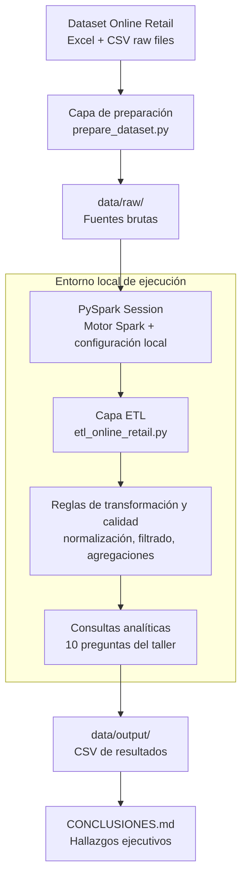

# Laboratorio Spark

Entorno local y ETL del Online Retail Dataset (UCI) con PySpark 3.5.6, orientado a análisis de comportamiento comercial, agregación de métricas y entrega de resultados en formato tabular para toma de decisiones.

## Autoría y portafolio

- Portfolio: https://oskar-ortiz.vercel.app
- GitHub: https://github.com/oskar-ortiz

## Visión arquitectónica empresarial



### Principios de diseño
- Separar la ingesta de datos brutos de la transformación y análisis lógico.
- Mantener un flujo reproducible y auditado para cada etapa del pipeline.
- Usar Spark como capa de cálculo y asegurar trazabilidad de artefactos de salida.
- Convertir cada pregunta de negocio en una consulta analítica verificable.
- Mantener un puente claro entre ingeniería de datos y reporting ejecutivo.

## Estado

- Java 17 portable: `.tools/jdk-17/`
- PySpark 3.5.6 en `.venv/`
- Hadoop Windows: `.hadoop/bin/winutils.exe` + `hadoop.dll`
- Dataset: `data/raw/Online Retail.xlsx` y `data/raw/online_retail.csv` (541909 filas)
- Resultados del taller: `data/output/` + `CONCLUSIONES.md`

## Activar el entorno

PowerShell:

```powershell
. .\scripts\activate.ps1
```

CMD:

```bat
call scripts\activate.bat
```

## Regenerar el CSV desde el Excel

```powershell
python .\scripts\prepare_dataset.py
```

## Prueba mínima de PySpark

```powershell
python .\scripts\smoke_test.py
```

## Ejecutar el ETL del taller

```powershell
python .\scripts\etl_online_retail.py
```

El script responde las 10 preguntas del taller, escribe un CSV por pregunta en `data/output/` y regenera `CONCLUSIONES.md`.

### Archivos de salida

| Archivo | Pregunta |
| --- | --- |
| `q01_total_facturas.csv` | Total de facturas |
| `q02_clientes_unicos.csv` | Clientes únicos |
| `q03_ingreso_total.csv` | Ingreso total neto |
| `q04_producto_mas_vendido.csv` | Producto más vendido |
| `q05_cliente_mayor_compra.csv` | Cliente con mayor compra |
| `q06_top_5_paises.csv` | Top 5 países fuera de UK |
| `q07_ticket_promedio.csv` | Ticket promedio |
| `q08_productos_por_factura.csv` | Min/max/avg productos por factura |
| `q09_mes_mas_ventas.csv` | Mes con más ventas |
| `q10_porcentaje_devoluciones.csv` | % facturas con devoluciones |
| `ranking_clientes_top_100.csv` | Ranking opcional con `rank()` |

## Criterios usados

- Ingreso neto: `Quantity * UnitPrice` (incluye cantidades negativas).
- Devoluciones: `Quantity < 0` o `InvoiceNo` que empieza por `C`.
- Producto más vendido: solo cantidades positivas.
- Productos por factura: referencias `StockCode` distintas.
